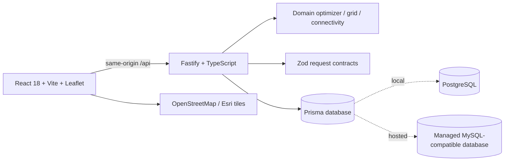

# EcoGrid AI 2.0

**EcoGrid AI** is a climate-planning workbench for turning a study-area grid into a budget-constrained, explainable set of urban heat and green-infrastructure interventions. It renders one clickable Leaflet polygon per analysis cell and includes deterministic demo scores, optimizer and connectivity workflows, what-if simulation, scenarios, analytics, report exports, and API contracts.

> The default Bengaluru East campus scores and named zones are deterministic illustrative planning inputs, not field measurements or engineering advice.

## Architecture



- **`apps/web`** — React, Vite, Tailwind, React Router, TanStack Query, Recharts, Lucide, Leaflet 1 polygon per cell. The map and charts load as separate chunks.
- **`apps/api`** — Fastify JSON API, session cookies, role checks, rate limiting, OpenAPI docs, exports and PDF reports.
- **`packages/domain`** — shared strict models, seeded grid, need-weighted greedy optimizer, what-if scoring and graph connectivity analysis.
- **`packages/contracts`** — shared Zod schemas for API inputs.
- **`apps/api/prisma/postgres` and `apps/api/prisma/mysql`** — provider-specific schema and additive migration trees. The data model stays aligned; local Compose uses PostgreSQL, while the hosted demo uses the managed MySQL-compatible `DATABASE_URL` supplied by the host.

## Quick start: Docker

Requirements: Docker Compose v2. From the repository root:

```bash
cp .env.example .env
# Replace the two ECOGRID_JWT_* values with independent random secrets (32+ characters).
# If you need password sign-in, also replace SEED_ADMIN_PASSWORD with a long unique value.
docker compose up --build
```

- Web workbench: <http://localhost:3000>
- API: <http://localhost:3001/api/health>
- OpenAPI UI: <http://localhost:3001/api/docs>
- PostgreSQL runs on `localhost:5432` and its Compose volume is named `ecogrid-postgres`.

The API service waits for the local database, applies the PostgreSQL migration, idempotently seeds the 100-cell demo study, then starts the API. The web service runs Vite and proxies `/api` to the API container. Stop with `Ctrl+C`; use `docker compose down` to stop services. **Do not run `docker compose down -v` unless you intend to erase the local database volume.**

## Quick start: local Node

Requirements: Node.js 22 and pnpm 11.25.0 (the repository pins pnpm through `packageManager`). PostgreSQL is optional for read-only/demo workflows; accounts, sessions and durable writes need a configured database.

```bash
corepack enable
corepack prepare pnpm@11.25.0 --activate
pnpm install --frozen-lockfile
pnpm run db:generate
pnpm dev
```

The Vite client is served at port 3000; the Fastify API uses port 3001. Local runtime uses `API_PORT`; production honors `PORT` (3000 by default). If using PostgreSQL, set `DATABASE_PROVIDER=postgres`, configure `DATABASE_URL`, then run `pnpm run db:migrate:postgres` and `pnpm run db:seed`. For a MySQL-compatible instance, select `DATABASE_PROVIDER=mysql`, configure its URL, and use `pnpm run db:migrate:mysql`.

Copy `.env.example` to `.env` before `docker compose up`. `.env` is ignored by Git. Do not commit real passwords or signing keys.

## Environment

| Variable | Purpose |
| --- | --- |
| `DATABASE_URL` | Runtime database connection. Never required at image build time. |
| `DATABASE_PROVIDER` | `postgres` for local Docker or `mysql` for the hosted database. A MySQL URL is also detected. |
| `ECOGRID_JWT_ACCESS_SECRET` | Independent access-token signing secret, at least 32 characters. |
| `ECOGRID_JWT_REFRESH_SECRET` | Independent refresh-token signing secret, at least 32 characters. |
| `ACCESS_TOKEN_TTL_SECONDS` | Access cookie lifetime; defaults to 900 seconds. |
| `REFRESH_TOKEN_TTL_DAYS` | Refresh cookie/session lifetime; defaults to 30 days. |
| `PUBLIC_HTTPS` | Set `true` when the public origin uses HTTPS and its scheme is not conveyed in the browser `Origin` header. Published image defaults to `true`; Docker Compose overrides to `false`. |
| `WEB_ORIGIN` | Optional comma-separated allowlist for cross-origin web clients. Same-origin deployment does not require CORS. |
| `SEED_ADMIN_EMAIL` / `SEED_ADMIN_PASSWORD` | Optional bootstrap administrator. The password must contain at least 12 characters; create it only in a private environment. |
| `API_PORT` | Local/dev Fastify listener (3001 by default). Production instead honors `PORT`. |
| `MODEL_URL` | Optional base URL of a trained-model service (see [Trained model integration](#trained-model-integration)). Empty keeps the built-in deterministic scores. |
| `MODEL_API_KEY` | Optional bearer key sent to the model service. |
| `MODEL_TIMEOUT_MS` | Model request timeout; defaults to 8000, capped at 60000. |

JWTs are stored in HttpOnly cookies, with `SameSite=None; Secure` for public HTTPS and `SameSite=Lax` for plain-HTTP local development. Refresh-token identifiers are hashed in the database and rotated on use. Registration creates a `viewer`; the seed bootstrap can create an `admin`. `planner` and `admin` roles may run or save plans. Do not grant planner/admin role via a public form.

## Data and scoring

The default study uses a configurable 10 × 10 rectangular grid (`A01`–`J10`) near 12.9352, 77.6245. Cell geometry is generated from origin, row/column count, cell-size and rotation. Named illustrative zones include North Gate, Academic Block, Central Plaza, Library Corridor and East Service Road. Each cell carries five normalized scores, green cover, feasibility, capacity, land use, surface type, priority status and confidence.

The Light and Dark basemaps use the standard OpenStreetMap raster tiles with visible attribution. Dark mode applies a CSS treatment to those same tiles, so it does not depend on a second provider or a browser key. Satellite imagery is supplied by Esri.

The map requests only tiles needed for the current viewport and keeps the OSM attribution visible. Respect the [OpenStreetMap tile usage policy](https://operations.osmfoundation.org/policies/tiles/) (including its cache headers and no-prefetch rule); automated map tests replace public raster requests with an in-memory test tile.

The hosted MySQL runtime preserves the managed DSN and adds Prisma's `sslaccept=strict` setting when it is absent, so API queries, seeding and the container's migration step use TLS. This matches [Prisma's MySQL SSL configuration](https://www.prisma.io/docs/orm/v6/overview/databases/mysql#configuring-an-ssl-connection) and [TiDB Cloud's Prisma connection guidance](https://docs.pingcap.com/developer/dev-guide-sample-application-nodejs-prisma/), which requires `sslaccept=strict` on the public Starter endpoint.

Combined Priority is `0.30 × heat + 0.25 × vegetation deficit + 0.25 × pedestrian exposure + 0.20 × connectivity need`. Risk colors use LOW 0–30 (`#7E9C8E`), MODERATE 31–60 (`#4CC38A`), HIGH 61–80 (`#F3B44E`) and CRITICAL 81–100 (`#E35D5D`).

The pure deterministic optimizer generates feasible cell/intervention candidates, scores weighted benefit by need and feasibility, selects by benefit per cost within available budget and capacity, and reports rejected candidates and validation violations. The five demo interventions are native trees, shade structures, pollinator corridors, green buffers, and cool/reflective surfaces.

CSV/GeoJSON score imports are persisted to the study's database cell records when a database is configured. The in-memory seeded demo mode remains available without a database; in that mode imports are intentionally process-local.

## Trained model integration

The API can fetch per-cell scores and confidence from an external model over HTTP. `model-service/` contains a FastAPI **stub** that implements the contract with a deterministic heuristic (not a trained model); replace `load_model()` / `predict_cell()` with your model and keep the request/response shapes.

```bash
# 1. run the stub (or your model)
cd model-service && pip install -r requirements.txt && uvicorn main:app --port 8000
# 2. point the API at it (.env)
MODEL_URL=http://localhost:8000
# 3. as a planner/admin: POST /api/studies/study-bengaluru-east/model/refresh
#    or use "Refresh from model" on the Data Sources page
```

With Docker Compose: `docker compose --profile model up --build` and set `MODEL_URL=http://model:8000` in `.env`.

Contract: `POST {MODEL_URL}/predict` with `{ studyId, cells: [{ id, row, col, lat, lng, landUse, surfaceType, existingGreenCover, capacity }] }` returns `{ modelVersion, predictions: [{ id, heat?, vegetation?, pedestrian?, connectivity?, confidence?, lower?, upper? }] }`; `GET {MODEL_URL}/health` returns `{ ok, modelVersion }`. Values are 0-1 and are clamped by the API. Omitted fields keep their current value. If the model is not configured, unreachable, slow, or returns an invalid response, the API keeps the existing scores and reports `source: "fallback"` with the reason. See `model-service/README.md`.

## API overview

All application routes are mounted under `/api`; health routes do not require authentication.

| Route | Method | Behavior |
| --- | --- | --- |
| `/api/health`, `/api/meta`, `/api/interventions` | GET | Health, defaults and intervention catalog. |
| `/api/studies`, `/api/studies/:id`, `/api/studies/:id/cells` | GET/POST | Create/list study areas and read cells, polygons and summary metrics. |
| `/api/optimize`, `/api/whatif`, `/api/connectivity` | POST/GET | Budget optimization, single-cell simulation, green-network analysis. Plan actions require a planner/admin session. |
| `/api/scenarios`, `/api/scenarios/:id`, `/api/scenarios/compare` | GET/POST/PATCH/DELETE | Create, read, edit, remove and compare stored scenarios. Mutations require planner/admin. |
| `/api/import`, `/api/export` | POST/GET | Import cell scores (and optional `confidence` / `dataConfidence`) as CSV or GeoJSON; export CSV or GeoJSON. |
| `/api/studies/:id/confidence` | GET | Confidence summary: mean, p10, p90 and count of cells below 0.6. |
| `/api/studies/:id/confidence/recompute` | POST | Recompute per-cell confidence from source inputs. Planner/admin. |
| `/api/model/health` | GET | Whether the model service is configured/reachable, its version, and the last refresh. |
| `/api/studies/:id/model/refresh` | POST | Fetch scores and confidence from the model service. Planner/admin. Keeps existing scores if the model fails. |
| `/api/studies/:id/report` | GET | JSON or PDF report (`format=json|pdf`). |
| `/api/auth/register`, `/api/auth/login`, `/api/auth/refresh`, `/api/auth/logout`, `/api/auth/me` | POST/GET | Email/password sessions and role-aware identity. |
| `/api/docs` | GET | Swagger UI. |

## Quality checks

```bash
pnpm run typecheck
pnpm run lint
pnpm run test
pnpm run build
pnpm run e2e
```

The Playwright suite asserts that every map route renders 100 visible Leaflet cell polygons, that layer changes recolor them without losing the grid, and that cell inspection, reset, zoom, basemap switching and plan optimization preserve the polygon count. The API suite exercises the registered Fastify routes using request injection.

## Hosted container deployment

The container serves the compiled React app and the API on the same listener. It honors the hosting-provided `PORT`, defaults to 3000, and exposes the unauthenticated readiness route `/api/health`. At runtime it chooses the matching provider migration tree and safely applies additive migrations before idempotently seeding the demo study. The hosted demo expects the managed MySQL-compatible `DATABASE_URL`, `DATABASE_PROVIDER=mysql`, and the two protected signing secrets. Local PostgreSQL files and hosted MySQL files share the same model structure but are maintained as separate Prisma schemas/migrations.

The web/API service must be published as a container (not as static-only output). Configure a health check for `/api/health`; do not put database credentials or JWT secrets in frontend build-time variables.


## Study-area setup and external geocoding

The Data Sources page includes a live polygon-grid setup preview. Planners can configure 1–50 rows and columns, angular cell dimensions, rotation and origin; drag the origin pin; submit an explicit place search; or upload a WGS84 GeoJSON boundary. Boundary import derives the grid's rectangular extent from the GeoJSON bounds; it does **not** clip cells to the irregular source outline or persist that outline as geometry, so users should review the cells against the source boundary. Default setup remains 10 × 10 and larger study grids are bounded at 2,500 cells.

Place search is deliberately submitted with a Search action instead of client-side autocomplete. The API uses Nominatim `format=jsonv2`, caches matching queries for 24 hours and serializes uncached requests at one per second per running process. The page displays Nominatim/OpenStreetMap attribution. Public-service use remains subject to the [official Nominatim Search API](https://nominatim.org/release-docs/latest/api/Search/) and [usage policy](https://operations.osmfoundation.org/policies/nominatim/); scaling beyond a modest interactive demo requires a provider or self-hosted service appropriate to the application's traffic. Source notes are kept in [`docs/external-data-sources.md`](docs/external-data-sources.md).

The new `GET /api/geocode/search?q=...` route is a thin server-side proxy; the browser does not need an API key. Persisted study creation remains authenticated to planner/admin roles through `POST /api/studies`.

Map PNG export downloads the visible map, current polygon layer, legend, scale and provider attribution. It attempts to include the current viewport imagery; if a browser or tile-provider CORS policy blocks raster capture, the downloaded fallback clearly states that tiles were omitted while retaining the grid, legend and attribution.

| Additional route | Method | Behavior |
| --- | --- | --- |
| `/api/geocode/search?q=...` | GET | Explicitly submitted, cached and one-per-second Nominatim place search; the browser does not call the public geocoder directly. |
