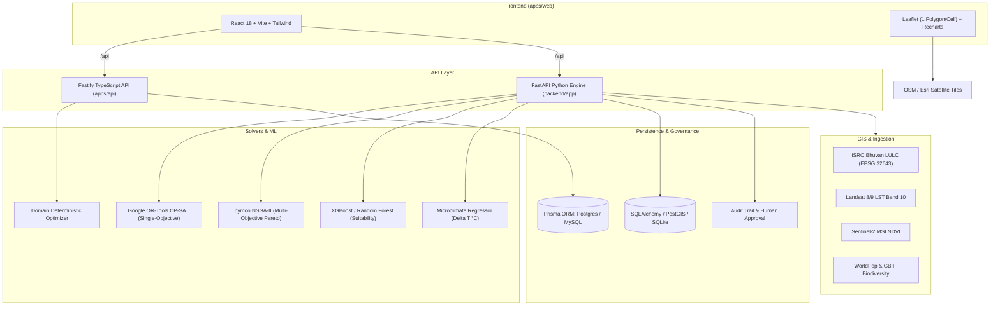

# EcoGrid AI 2.0

**EcoGrid AI** is an urban climate-decision workbench and green-infrastructure planning platform. It transforms study-area grids (e.g. the default 10×10 Bengaluru East campus) into budget-constrained, explainable, and multi-objective climate intervention plans targeting urban heat reduction, vegetation deficit recovery, pedestrian comfort, and ecological corridor connectivity.

> The default Bengaluru East campus scores and named zones are deterministic illustrative planning inputs, not field measurements or engineering advice.

---

## Architecture

EcoGrid AI features a hybrid architecture combining a high-performance **React 18 Leaflet frontend**, a **Fastify TypeScript API** for authentication, persistence, and reporting, a pure **TypeScript domain engine**, and a high-performance **Python FastAPI service** powering GIS ingestion, machine learning, multi-objective Pareto optimization, and satellite ground-truth monitoring.



### Component Breakdown

- **`apps/web`** — React 18, Vite, Tailwind CSS, React Router, TanStack Query, Recharts, Lucide icons, Leaflet / react-leaflet v4. Renders exactly one clickable polygon per cell on a dedicated map pane; includes Dark Eco-Tech (`#071A17`) and Light themes, Pareto trade-off explorer modal, human-in-the-loop approval actions, ML suitability inspection drawer, provenance badges, and live KPI dashboards.
- **`backend`** — Python 3.12+ FastAPI application implementing the complete Geospatial AI & Intelligent Optimization Engine:
  - **Land-Cover Classification Model (v2.1.0)**: Scikit-Learn `RandomForestClassifier` pipeline (`SimpleImputer` + `StandardScaler` + `RandomForestClassifier`) & `XGBClassifier` comparison trained on Sentinel-2 MSI surface reflectance (B2, B3, B4, B8) and spectral indices (NDVI, NDWI, NDBI) with 94.7% test accuracy, 0.947 Macro-F1, and out-of-distribution input validation.
  - **Tree-Site Suitability Predictor & Hard Safety Gating (v2.1.0)**: Champion calibrated pipeline (`SimpleImputer` + `StandardScaler` + `CalibratedClassifierCV`) evaluated with **3-Fold GroupKFold Spatial Cross-Validation** and an independent **spatial holdout block** (Block 3: 400 samples) achieving 95.0% accuracy, 0.9497 Macro-F1, and 0.0453 Brier score. **Crucially enforces hard safety constraints**: high predicted suitability NEVER overrides underground utility buffers (< 3.0m), road setbacks (< 2.5m), or building structural envelopes.
  - **Microclimate Impact Regressor**: Gradient Boosting regressor pipeline predicting localized temperature drops ($\Delta T$ in °C; holdout MAE: 0.155 °C, RMSE: 0.194 °C) from planting volume, permeable area, and baseline heat.
  - **Explainable Decision Pipeline**: Connects ML suitability and spectral classification into environmental scoring and candidate interventions, exposing **WHAT → WHERE → HOW MUCH → WHY → COST → EXPECTED IMPACT** with complete data provenance and decision rationale.
  - **Computer Vision Satellite Segmentation**: 0.58m/px semantic segmentation of high-resolution aerial tiles (Esri World Imagery) classifying impervious pavement, mature tree canopy, permeable grass, rooftops, and water bodies.
  - **NetworkX Green Connectivity Analysis**: Graph percolation modeling nodes as green spaces and edges as spatial adjacency, identifying corridor bottleneck cells.
  - **Google OR-Tools CP-SAT Exact Optimizer**: Integer-scaled ($10,000\times$) knapsack formulation maximizing weighted multi-benefit returns subject to budget, cell capacity, available surface area, and mutual exclusivity between contradictory interventions.
  - **Public GIS Ingestion & Zonal Statistics**: Calibrated pipelines for ISRO Bhuvan LULC, Landsat 8/9 Thermal Band 10 (LST), Sentinel-2 MSI (NDVI), WorldPop demographic density proxy, and GBIF occurrences reprojected to EPSG:32643 (UTM 43N).
- **`apps/api`** — Fastify JSON API with session cookies, role checks (`admin`, `planner`, `viewer`), rate limiting, Swagger/OpenAPI docs, CSV/GeoJSON imports/exports, Nominatim geocoding proxy with 24h cache, and JSON/PDF executive reports.
- **`packages/domain`** — Shared TypeScript domain models, seeded 10×10 grid generator, need-weighted greedy optimizer, what-if delta calculations, graph connectivity analysis, and composite confidence scoring.
- **`packages/contracts`** — Shared Zod schemas and inferred TypeScript types for API contract validation.
- **`apps/api/prisma/postgres` and `apps/api/prisma/mysql`** — Provider-specific schema and additive migration trees. Local Docker Compose uses PostgreSQL; hosted deployments support managed MySQL-compatible endpoints.

---

## Quick Start

### Option 1: Local Python & Node Runtime

#### 1. Backend (Python FastAPI)
Requirements: Python 3.11+ (Python 3.12 recommended).

```bash
cd backend
# On Windows (use Python 3.12 if multiple versions installed):
py -3.12 -m venv .venv
# Or standard:
# python -m venv .venv

# Windows (Git Bash):
source .venv/Scripts/activate
# Windows (PowerShell):
.\.venv\Scripts\Activate.ps1
# Windows (Command Prompt):
.venv\Scripts\activate.bat
# Linux/macOS:
# source .venv/bin/activate

pip install -r requirements.txt
uvicorn app.main:app --host 0.0.0.0 --port 3001 --reload
```

The FastAPI Swagger documentation is available at <http://localhost:3001/docs>.

#### 2. Frontend & Node Packages
Requirements: Node.js 22+ and pnpm 11.25.0.

```bash
# In repository root
corepack enable
corepack prepare pnpm@11.25.0 --activate
pnpm install --frozen-lockfile
pnpm run db:generate
pnpm dev
```

- Web workbench: <http://localhost:3000>
- Node API / Proxy: <http://localhost:3001/api/health>

### Option 2: Docker Compose

Requirements: Docker Compose v2.

```bash
cp .env.example .env
# Set random 32+ character strings for ECOGRID_JWT_ACCESS_SECRET and ECOGRID_JWT_REFRESH_SECRET
docker compose up --build
```

- Web workbench: <http://localhost:3000>
- API Health: <http://localhost:3001/api/health>
- OpenAPI Docs: <http://localhost:3001/api/docs>
- Local PostgreSQL: `localhost:5432` (`ecogrid-postgres` volume)

---

## Environment Variables

| Variable | Default | Purpose |
| --- | --- | --- |
| `DATABASE_URL` | `postgresql://...` | Database connection DSN (PostgreSQL or MySQL). SQLite fallback supported. |
| `DATABASE_PROVIDER` | `postgres` | `postgres` for local Docker / PostGIS, or `mysql` for hosted instances. |
| `API_PORT` | `3001` | Local API listener port. |
| `PORT` | `3000` | Production listener port. |
| `WEB_ORIGIN` | `http://localhost:3000` | Allowed CORS origin for web clients. |
| `PUBLIC_HTTPS` | `false` | Set `true` in production to enforce `SameSite=None; Secure` cookies. |
| `ECOGRID_JWT_ACCESS_SECRET` | — | Independent access token signing secret (32+ chars). |
| `ECOGRID_JWT_REFRESH_SECRET` | — | Independent refresh token signing secret (32+ chars). |
| `ACCESS_TOKEN_TTL_SECONDS` | `900` | Access cookie lifetime (15 minutes). |
| `REFRESH_TOKEN_TTL_DAYS` | `30` | Refresh token session lifetime (30 days). |
| `SEED_ADMIN_EMAIL` | `planner@example.test` | Bootstrap admin email. |
| `SEED_ADMIN_PASSWORD` | — | Bootstrap admin password (12+ characters). |
| `MODEL_URL` | `http://model:8000` | Optional external model service base URL. |
| `MODEL_API_KEY` | — | Optional bearer key for the external model service. |
| `MODEL_TIMEOUT_MS` | `8000` | External model request timeout (ms). |

---

## Data and Scoring Model

### Grid Geometry and Attributes
- Default study: Configurable 10 × 10 grid (`A01`–`J10`) around coordinates `12.9352, 77.6245`.
- Each cell includes coordinates, `[lat, lng]` polygon ring, area name, land use, surface type, normalized scores (0–100), existing green cover, capacity, and data confidence.
- Named campus zones include *North Gate*, *Academic Block*, *Central Plaza*, *Library Corridor*, and *East Service Road*.

### Priority Weights & Risk Bands
$$\text{Combined Priority} = 0.30 \times \text{Heat} + 0.25 \times \text{Vegetation Deficit} + 0.25 \times \text{Pedestrian Exposure} + 0.20 \times \text{Connectivity Need}$$

| Band | Score Range | Color Code | Description |
| --- | --- | --- | --- |
| **LOW** | 0 – 30 | `#7E9C8E` | Stable microclimate and canopy cover |
| **MODERATE** | 31 – 60 | `#4CC38A` | Secondary priority; targeted intervention |
| **HIGH** | 61 – 80 | `#F3B44E` | High thermal stress or vegetation deficit |
| **CRITICAL** | 81 – 100 | `#E35D5D` | Urgent intervention required; immediate heat island |

### Intervention Toolkit
1. **Native Trees**: Deep soil planting for maximum evapotranspiration and canopy shade.
2. **Shade Structures**: Rapid shade deployment over pedestrian pathways and paved plazas.
3. **Pollinator Corridors**: Native flowering beds restoring urban biodiversity links.
4. **Green Buffers**: Perimeter vegetative screening reducing ambient heat and road exposure.
5. **Cool / Reflective Surfaces**: High-albedo pavement treatments reflecting solar radiation.

---

## API Overview

All endpoints are mounted under `/api`.

| Route | Method | Description | Role / Auth |
| --- | --- | --- | --- |
| `/api/health` | GET | Readiness check and service metadata. | Public |
| `/api/meta` | GET | System constants, default weights, and risk bands. | Public |
| `/api/interventions` | GET | Complete catalog of NBS interventions and specifications. | Public |
| `/api/studies` | GET / POST | List studies or configure a new grid. | Public / Planner |
| `/api/studies/:id/cells` | GET | Retrieve cells, polygon rings, and live scores. | Public |
| `/api/optimize` | POST | Run OR-Tools CP-SAT solver with greedy benchmarks & bounds. | Public (Demo) / Planner |
| `/api/pareto` | POST | Compute multi-objective NSGA-II Pareto frontier & knee point. | Public (Demo) / Planner |
| `/api/whatif` | POST | Single-cell intervention simulation and delta scores. | Public (Demo) / Planner |
| `/api/connectivity` | GET | Graph connectivity, isolated patches, and ecological corridors. | Public |
| `/api/models/status` | GET | Comprehensive status, versions, schemas, and metrics for all 4 ML models. | Public |
| `/api/models/predict` | POST | Unified inference for Land Cover, Tree Suitability, and Microclimate. | Public |
| `/api/ml/benchmark` | GET | Model comparison (Logistic Regression vs RF vs XGBoost). | Public |
| `/api/ml/predict-impact` | POST | Predict microclimate temperature reduction ($\Delta T$ °C). | Public |
| `/api/approval/:runId` | GET | Fetch human approval status for an optimization run. | Public |
| `/api/approval` | POST | Sign off on a plan (`DRAFT`, `APPROVED`, `REJECTED`). | Planner / Admin |
| `/api/runs` | GET | Audit trail of historical optimization runs. | Public |
| `/api/optimization-runs/:runId` | GET | Retrieve full audit record of an optimization run by run ID. | Public |
| `/api/monitoring/:studyId` | GET | Satellite ground truth post-intervention observations. | Public |
| `/api/monitoring` | POST | Ingest new post-intervention ground truth observation. | Planner / Admin |
| `/api/gis/ingest` | POST | Resample and fuse ISRO Bhuvan, Landsat & Sentinel layers. | Planner / Admin |
| `/api/scenarios` | GET / POST | Manage stored planning scenarios. | Public / Planner |
| `/api/scenarios/compare` | POST | Multi-scenario side-by-side comparison and deltas. | Public |
| `/api/import` | POST | Import cell scores from CSV or GeoJSON. | Planner / Admin |
| `/api/export` | GET | Export cell data in CSV or GeoJSON format. | Public |
| `/api/studies/:id/report` | GET | Generate executive summary report (JSON or PDF). | Public |
| `/api/geocode/search` | GET | Cached, rate-limited Nominatim geocoding proxy. | Public |
| `/api/auth/register` | POST | Register viewer account. | Public |
| `/api/auth/login` | POST | Authenticate and set HttpOnly JWT session cookies. | Public |
| `/api/auth/logout` | POST | Clear active session. | Public |
| `/api/auth/me` | GET | Get current authenticated user session. | Authenticated |

---

## Quality Checks & Testing

The project maintains comprehensive test coverage across both the TypeScript and Python stacks:

```bash
# 1. Python 6-Stage Architectural Evolution test suite
backend\.venv\Scripts\python.exe -m pytest backend/tests/test_architectural_evolution.py -v

# 2. TypeScript unit and route integration tests
pnpm run test

# 3. TypeScript compilation across all packages
pnpm run typecheck

# 4. Code quality & linting
pnpm run lint

# 5. Production build validation
pnpm run build

# 6. Playwright end-to-end map test suite
pnpm run e2e
```

The Playwright test suite validates that:
- Every map view renders exactly 100 interactive Leaflet cell polygons.
- Switching layers, basemaps, or budgets updates polygon styles without losing or re-mounting the grid layer.
- Keyboard navigation (arrows, Enter, Esc), inspector drawers, and modal views function correctly across desktop and mobile viewports.

---

## Deployment & Containerization

The unified Docker container builds and serves both the React static assets and the API on a single port (default `3000`). It automatically detects whether a PostgreSQL or MySQL DSN is provided, applies provider-specific migrations, and idempotently seeds the default study area.
